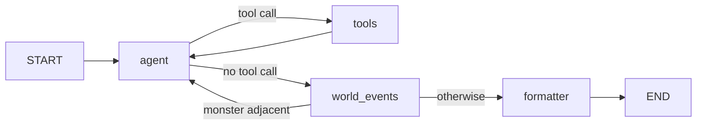

# D&D Game Master agent (LangGraph)

A ReAct agent that plays the Game Master in a small D&D-style game. The player types actions in Ukrainian; the agent decides which tools to call (dice, HP, movement, map edits), applies the results to the game state, and answers in a structured form. The terminal UI shows the map, the character, and the chat. Every run writes a trajectory and evaluation results to `outputs/`.

The game interface and the in-world text are in Ukrainian. Code identifiers, tests, and this README are in English.

## Setup

Requirements: Python 3.12 and an OpenAI API key with access to the configured model.

```bash
python3.12 -m venv .venv
.venv/bin/python -m pip install -r requirements.txt
```

Create `.env` in the project root (it is git-ignored and must not be committed):

```
OPENAI_API_KEY=your-key-here
```

The model name is set in `dnd_agent/config.py` (`MODEL_NAME`).

## Running

| Command | What it does | Needs API |
|---|---|---|
| `.venv/bin/python main.py play` | Play in the terminal: map, character, chat. Slash commands: `/map`, `/state`, `/new`, `/quit`. Ctrl+C or Ctrl+D exits. | yes |
| `.venv/bin/python main.py demo-safety` | Show the three safety mechanisms on scripted models. | no |
| `.venv/bin/python main.py check` | Smoke test: one call to the model. | yes |
| `.venv/bin/python -m pytest -q` | Unit and integration tests (scripted models, no network). | no |

The CLI only contains game-related commands. Evaluation is kept out of it and lives in the `evaluation/` package:

```
.venv/bin/python -c "from evaluation.runner import run_eval; run_eval()"      # 5 evaluation cases, real model
.venv/bin/python -c "from evaluation.tryout import run_tryout; run_tryout()"  # fixed 7-turn scenario, real model
```

Each `play` game and each evaluation run gets its own folder in `outputs/` (git-ignored). The folder name is the run ID, for example `20261123-123855-abe4`.

## How it works

### Game world

- The map is an 8x8 grid loaded from `game_data/worlds/*.json`. Coordinates are `(x, y)` with `x` as the column and `y` as the row, both counted from 0. Cell types: floor, tree, wall, water, monster, treasure.
- Characters are loaded from `game_data/characters/*.json`. A character has HP, a position, and modifiers for six attributes (strength, dexterity, constitution, intelligence, wisdom, charisma).
- Trees, walls, water, and monsters block movement. Walls and water are permanent; other cells can be changed with `modify_map`. The cell the character stands on cannot be changed.

### Tools

Four tools are defined as Pydantic models with field descriptions and validators. The model calls them one at a time.

| Tool | Purpose | Main validation |
|---|---|---|
| `roll_dice` | Roll dice (`NdM`), add an attribute modifier and a situational modifier | Dice notation, allowed die sizes, modifier range |
| `modify_hp` | Deal damage or heal, clamped to 0..max HP | Non-zero delta within ±50 |
| `move_character` | Move 1-5 cells in one direction; stops at the first obstacle | Direction enum (any letter case is accepted), steps 1-5 |
| `modify_map` | Change one map cell, e.g. remove a defeated monster | Coordinates on the 8x8 map (0..7), cell names, reason length; the game rules reject changes to walls, water, or the player's cell |

Every tool input model has a `field_validator` next to the `Field` limits:

| Tool | `field_validator` |
|---|---|
| `roll_dice` | `dice` must be valid notation `NdM` with an allowed die size |
| `modify_hp` | `delta` must not be 0 |
| `move_character` | `direction` is stripped and lower-cased before the enum check, so `"East"` is accepted |
| `modify_map` | `x` and `y` must lie on the 8x8 map (`MAP_SIZE` in `dnd_agent/game/world.py`) |

Tools update the state through `Command` objects. A tool error (e.g. an illegal map edit) returns a tool message with `status="error"`, which the model sees and can correct.

### Agent graph



- **agent**: the LLM sees the system prompt, the current state (HP, position, map around the player), and the chat history. It answers with a tool call or with text.
- **tools**: runs the requested tool and merges its result into the state.
- **world_events**: code (not the LLM) checks whether a monster is next to the player. If so, it adds a `[Подія світу]` message, and the agent resolves the monster's attack with `roll_dice` and `modify_hp`. This happens at most once per player turn.
- **formatter**: a second model call with structured output (`answer`, `confidence`). The `sources` field (which tools ran this turn) is filled in by code, not by the model.

The conversation state is kept by a `MemorySaver` checkpointer, so a game continues across turns. The state holds the character and the map, and tools update them in place.

### Safety mechanisms

All limits are checked inside the agent node before each model call. Each one stops the turn with a system message, and the formatter then gives the player a short wrap-up.

| Mechanism | Setting | Where |
|---|---|---|
| Step limit | 8 model calls per player turn | `dnd_agent/safety/limits.py` |
| Turn timeout | 90 s from the first model call of the turn | `dnd_agent/safety/timeout.py` |
| Request timeout | 30 s per model request, one retry | `dnd_agent/safety/timeout.py` |
| Loop detector | same tool with the same arguments 3 times in one turn; `roll_dice` exempt | `dnd_agent/safety/loop_detector.py` |

The step limit counts model calls from the message history of the current turn, so it resets on each new player message. A recursion limit of 100 in the graph is a last-resort backstop.

### Trajectories

`TrajectoryLogger` records every node update of a play session or an evaluation run:

- model calls and tool calls with arguments, tool results and their status,
- world events, the agent's text, HP and position after each change,
- the GM answer, confidence, and sources,
- per turn: model calls, tool calls, stop reason (`limit`, `timeout`, `loop`, or none), seconds, final state, and an error if one occurred.

Files written per run:

- `run_meta.json`: run ID, command, status, start and finish times, totals.
- `trajectory.json`: all turns, rewritten after each turn.
- `test_results.json` (eval only): per case, the difficulty, the query, expected and actual values, each check, the steps, the tool calls, and the time.

## Tests

`pytest` runs 103 tests. The tests cover:

- the world (map validation, cell rules, surroundings), the loader, and the four tools, with valid and invalid inputs,
- the safety mechanisms (step limit, timeout, loop detector) through the full graph with scripted models,
- the world-event loop, the trajectory logger, and the evaluation runner.

## Evaluation results

### Evaluation cases

`run_eval()` from `evaluation/runner.py` runs seven single-turn cases against the real model. Each case starts a new game and has a difficulty label:

- **simple**: one action, one tool.
- **medium**: one goal that needs knowledge of the state, or several calls of the same kind.
- **complex**: a chain of different tools where each action depends on the previous one.

| Case | Difficulty | Player says | Checks |
|---|---|---|---|
| `move_two_steps` | simple | "Іду на схід два кроки." | calls `move_character`; ends at (2, 3) |
| `trap_damage` | simple | "Мене вдарила пастка, це 5 шкоди." | calls `modify_hp`; HP 16 -> 11 |
| `attack_roll` | medium | "Атакую гобліна мечем!" (player starts next to the goblin) | calls `roll_dice` |
| `blocked_by_tree` | medium | "Іду на захід на одну клітинку." (player starts at (2, 4)) | calls `move_character`; stays at (2, 4) |
| `monster_attacks` | medium | "Огляньмося навколо." (player starts next to the goblin) | world event fires; calls `roll_dice` |
| `walk_to_treasure` | medium | "Іди на схід до скарбу." | the treasure is 6 cells away and one call moves at most 5, so `move_character` must be called twice in a row; ends at (6, 3) |
| `approach_attack_remove` | complex | "Підійди до гобліна, атакуй його мечем і, якщо переміг, прибери його з карти. Гоблін слабкий: будь-який кидок атаки його вбиває." (player starts at (5, 2)) | tools in order `move_character` -> `roll_dice` -> `modify_map`; stops at (4, 2) because the goblin blocks the way; the goblin's cell (3, 2) becomes floor |

The complex case states that any attack roll kills the goblin. Without that sentence, the "if he won" branch would depend on the hit rule the GM invents (known issue 2), and the case would pass or fail by luck.

Besides the tools, position, HP, and world event, the runner has two more checks: `sequence` (the tools appear in the expected order, other calls may sit between them) and `floor` (a given cell is floor after the turn, read from the final game state).

### Results

| Run | Passed | Notes |
|---|---|---|
| `20261123-123801-76d3` | 4 / 5 | `attack_roll` started three cells from the goblin. The model refused to attack and asked the player to move closer, which is the correct behavior. The case was wrong, so the case was fixed. |
| `20261123-123855-abe4` | 5 / 5 | Corrected case, the first five cases only. Turn times 5-13 s. |
| `20261123-170118-fef2` | 7 / 7 | All seven cases, including `walk_to_treasure` and the complex `approach_attack_remove`. |

Results of the last run (`20261123-170118-fef2`, model `gpt-6-luna`). "Steps" are the node updates recorded in the trajectory (`agent`, `tools`, `world_events`, `formatter`). "Tool calls" are the calls the model made during the turn.

| Test ID | Difficulty | Steps | Tool calls | Time, s |
|---|---|---|---|---|
| `move_two_steps` | simple | 4 | 1: `move_character` | 15.3 |
| `trap_damage` | simple | 4 | 1: `modify_hp` | 11.6 |
| `attack_roll` | medium | 12 | 4: `roll_dice` (attack), `roll_dice` (goblin's attack), `roll_dice` (damage), `modify_hp` | 25.1 |
| `blocked_by_tree` | medium | 4 | 1: `move_character` | 7.0 |
| `monster_attacks` | medium | 6 | 1: `roll_dice` | 11.7 |
| `walk_to_treasure` | medium | 6 | 2: `move_character`, `move_character` | 14.5 |
| `approach_attack_remove` | complex | 8 | 3: `move_character`, `roll_dice`, `modify_map` | 11.7 |

Averages by difficulty:

| Difficulty | Cases | Avg steps | Avg tool calls | Avg time, s |
|---|---|---|---|---|
| simple | 2 | 4.0 | 1.0 | 13.5 |
| medium | 4 | 7.0 | 2.0 | 14.6 |
| complex | 1 | 8.0 | 3.0 | 11.7 |

**Simple against complex.** Steps and tool calls grow with the difficulty: a simple case takes 4 steps and 1 tool call, the complex case takes 8 steps and 3 tool calls. Time depends on the order of the run more than on the difficulty. In the first run, the two simple cases ran first and were the slowest per request. In the second run (complex first), the complex case was the slowest, with the first request taking 4.9 s. In both runs the first case was slowest, and the other cases took about 1.5 to 2.5 s per request. So the cost of a case is best measured in model requests, steps and tool calls, not in seconds. The difficulty label describes how much planning a case needs, not how much it costs. The world event did not fire in the complex case, because the goblin was removed from the map before the world-event check.

### Analysis

**What works.** The model chooses the right tool for clear actions, and the tool results change the state correctly in every case of the last run. In the complex case the model planned the three-tool chain in the right order (move, attack roll, map edit), and the goblin's cell became floor. The world-event loop works on the real model: the goblin attacks without a player request, the model rolls the attack and the damage, and applies them. The model also refuses actions that the state does not allow (a melee attack from three cells away), and it explains the reason.

**What the checks do not cover.** The evaluation checks which tools ran and what the state is after the turn. It does not check the narration. In an earlier run of `move_two_steps`, the tool reported the move to (2, 3), but the GM wrote that the character "stayed in place". The check passed because the state was right. Narration quality needs its own checks (for example, does the answer mention the position the state reports?).

**Problems seen in the scripted scenario (7 turns).** Several are still open:

- Standing on treasure hides it: the map shows `@` on the player's cell, so the GM says there is no treasure there.
- Attacks have no hit or miss rule. The `roll_dice` tool returns a number without a target, so the GM decides the outcome itself. In one run the GM refused a valid "goblin defeated" request, and the next turn it contradicted its own earlier text.
- The GM invents scenery that is not on the map (ruins, a river, bushes). Part of this comes from the world description, which mentions ruins, a river, and a goblin in the bushes, while the map has none of them.
- HP narration is sometimes confused even when the tool result is correct.
- The error-recovery turn never triggers an error: the model splits a 10-step move into two valid 5-step moves.

**Confidence.** The `confidence` field is self-reported and was 1.0 in most turns. It does not carry useful information yet. A better signal would come from the checks above.

**Safety mechanisms.** The step limit, the turn timeout, and the loop detector were tested with scripted models, which are deterministic. In the real runs so far none of them fired, so their behavior with the real model is untested. The per-request timeout has not been triggered in a real run either.

**Sample size.** The evaluation is seven cases (two simple, four medium, one complex) and one run per version. There is only one complex case, so the simple-against-complex comparison is an illustration, not a statistic. Model output varies between runs, so the pass rate is a rough indication, not a benchmark.

## Known issues

1. Treasure under the player is hidden by the `@` marker (`surroundings` skips the player's cell and `_render` draws `@`). No test covers this yet.
2. Attacks have no target number or hit and miss rule; outcomes are decided by the GM's text.
3. The GM narrates scenery that is not in the state, and sometimes contradicts the tool results in its text.
4. The narration is not checked by the evaluation, only the tool calls and the state.
5. The confidence value is self-reported.
6. The try-out scenario never puts the player next to the goblin in a way that triggers the world event. The evaluation case does.
7. The safety limits have not been triggered by the real model.

## Project layout

```
main.py                   CLI: play, demo-safety, check
requirements.txt
dnd_agent/
  config.py               paths, model name, .env loading
  constants.py            constants shared by several modules
  agent/                  graph, nodes, state, prompts, structured output schema
  tools/                  roll_dice, modify_hp, move_character, modify_map
  game/                   character, world (map rules), loader, world events
  safety/                 step limit, timeouts, loop detector, demo
  audit/trajectory.py     per-run trajectory logging
  ui/                     terminal UI: rendering, play loop, slash commands
  utils/                  run context, JSON helpers, timing
evaluation/
  test_cases.py           the seven evaluation cases with difficulty labels
  runner.py               runs the cases, checks results, writes test_results.json
  tryout.py               scripted 7-turn scenario
game_data/                worlds and characters (JSON)
tests/                    pytest suite
outputs/                  run folders (git-ignored)
```
